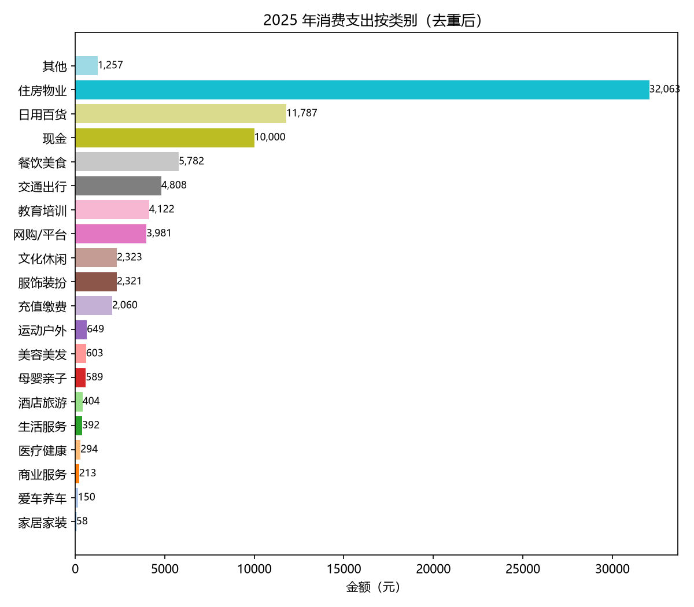
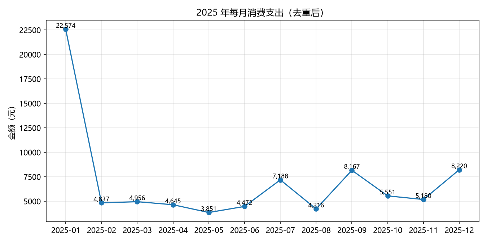

# 2025 年度消费支出分析报告

> 数据源：微信支付流水、支付宝交易明细、中信银行流水、招商银行流水（覆盖 2025-01-01 ~ 2025-12-30）

**去重后消费支出总额：83,857.43 元**

## 一、按类别汇总

| 类别 | 笔数 | 金额(元) | 占比 |
| --- | ---: | ---: | ---: |
| 住房物业 | 18 | 32,063.37 | 38.24% |
| 日用百货 | 278 | 11,786.95 | 14.06% |
| 现金 | 2 | 10,000.00 | 11.93% |
| 餐饮美食 | 182 | 5,782.43 | 6.90% |
| 交通出行 | 54 | 4,808.18 | 5.73% |
| 教育培训 | 1 | 4,122.00 | 4.92% |
| 网购/平台 | 36 | 3,980.63 | 4.75% |
| 文化休闲 | 41 | 2,322.74 | 2.77% |
| 服饰装扮 | 15 | 2,320.66 | 2.77% |
| 充值缴费 | 30 | 2,060.40 | 2.46% |
| 运动户外 | 7 | 649.00 | 0.77% |
| 美容美发 | 14 | 603.00 | 0.72% |
| 母婴亲子 | 11 | 588.88 | 0.70% |
| 酒店旅游 | 4 | 404.00 | 0.48% |
| 生活服务 | 24 | 392.50 | 0.47% |
| 医疗健康 | 24 | 294.20 | 0.35% |
| 商业服务 | 8 | 213.34 | 0.25% |
| 爱车养车 | 1 | 150.00 | 0.18% |
| 家居家装 | 3 | 58.00 | 0.07% |
| 其他 | 40 | 1,257.15 | 1.50% |

## 二、月度趋势

| 月份 | 支出(元) |
| --- | ---: |
| 2025-01 | 22,574.21 |
| 2025-02 | 4,837.46 |
| 2025-03 | 4,956.17 |
| 2025-04 | 4,644.94 |
| 2025-05 | 3,851.45 |
| 2025-06 | 4,472.27 |
| 2025-07 | 7,187.68 |
| 2025-08 | 4,215.51 |
| 2025-09 | 8,167.00 |
| 2025-10 | 5,551.11 |
| 2025-11 | 5,179.80 |
| 2025-12 | 8,219.83 |

## 三、主力购物平台

拼多多/淘宝/京东/抖音 上的消费小计（按交易对方匹配，**含全品类**，不限「网购/平台」类别）：

| 平台 | 笔数 | 金额(元) |
| --- | ---: | ---: |
| 拼多多 | 147 | 12,236.92 |
| 京东 | 33 | 1,636.15 |
| 淘宝 | 29 | 417.20 |

## 四、去重说明

同一笔消费会在「发生点」（微信/支付宝流水）和「结算点」（银行流水）各出现一次，本报告只在发生点计入：

- 剔除银行**信用卡账单还款**：15,541.49 元（对应信用购消费，已在支付宝流水中计入）
- 剔除银行**财付通(微信)结算**：14,554.15 元（对应微信流水中的消费）
- 剔除银行**支付宝结算**：188,515.98 元（对应支付宝流水中的消费）

## 五、不计入消费的资金流动

- **储蓄投资**（大额存单、银证转账、基金转入等）：5,823,994.32 元
- **转账往来**：15,400.00 元（银行转账 5,000.00、微信转个人 10,400.00、支付宝信用借还等 0.00；指定账号 >1,000 元转家人往来已加密隐藏）
- **内部转账**（本人账户间划转）：28,000.00 元
- **加班打车(已报销)**：7,659.74 元（网约车支出由单位报销，不计入消费；对应银行收入报销 7,659.74 元）
  - 2025-02-21 入账 1,344.64 元（广州腾讯凯博信息科技有限公转账8110901013501308779司）— 命中报销入账方
  - 2025-03-17 入账 753.88 元（广州腾讯凯博信息科技有限公转账8110901013501308779司）— 命中报销入账方
  - 2025-05-15 入账 326.11 元（广州腾讯凯博信息科技有限公转账8110901013501308779司）— 命中报销入账方
  - 2025-08-06 入账 1,773.46 元（广州腾讯凯博信息科技有限公转账8110901013501308779司）— 命中报销入账方
  - 2025-11-06 入账 2,300.88 元（广州腾讯凯博信息科技有限公转账8110901013501308779司）— 命中报销入账方
  - 2025-11-29 入账 1,160.77 元（广州腾讯凯博信息科技有限公转账8110901013501308779司）— 命中报销入账方

## 六、复核要点

- 「其他」1,257.15 元 = 微信「广州天慈」1.80、微信「家明」9.00、微信「🥥」12.00、微信「Linna.小琳🐳」50.00、微信「石昌胜」40.00、微信「蒋晶」31.00、微信「李美凤」109.00、微信「珊珊」22.00、微信「Lz」10.00、微信「杰瑞鼠（洪颖） (Jerry)」20.00、微信「花开花落」5.00、微信「刘伟」68.45、微信「喜酱天下酒厂诚招代理商🌹邓菲」10.00、微信「商户_嬴勇文」3.00、微信「Linna.小琳🐳」50.00、微信「滚马想」10.00、微信「bpmf」5.00、微信「微笑」10.00、微信「Lz」10.00、微信「Linna.小琳🐳」50.00、微信「小岳」10.00、微信「suu」14.00、微信「余红昌」4.00、微信「高」8.00、微信「suu」14.00、微信「强骏」10.00、微信「Lz」10.00、微信「张胜华」10.00、微信「无本万利👋」265.00、微信「不知从何说起」8.00、微信「李恩林」5.00、微信「李香玲」39.00、微信「秋实菊英」16.00、微信「童心」48.00、微信「三月的雪」10.00、微信「李儒美」50.00、微信「肖新民」8.00、支付宝「**金」8.00、支付宝「*巧」169.00、银行「快捷支付深圳市中融小额贷款有限公司8」24.90（无法判定商户，请核对）
- 退款冲减共 2,348.64 元（退款已按净额冲减，明细不单列退款行；全部退款的交易不再出现）
- 微信「当前状态 = 已全额退款」的行已整笔排除、不再计入（共 109.00 元，龙石战争/南方医院小额退款，支出侧与退款侧都不出现）
- 网约车支出 7,945.24 元中已报销 7,659.74 元，剩余 285.50 元仍计入交通出行
- 入账方「广州腾讯凯博信息」2025-06-09 入账 31,578.54 元为工资额度（≥20,000 元），未计入报销，已按工资处理
- 工资收入两条渠道（不计入报销，仅此说明）：1–5 月由「上海外服江苏人力资源」二代支付入账（1/09 36,506.01、1/24 33,920.00、2/08 43,560.01、3/07 34,463.37、4/09 34,463.36、5/09 33,481.57，6 笔约 21.6 万）；6 月起改由「广州腾讯凯博信息」发放（6/09 转账 31,578.54 + 7–12 月代发工资约 3.0–3.2 万/月）
- 教育培训 4,122.00 元 = 广东志跃体育 收款码留言「聂知一 50课时」（已按「课时」关键字归教育培训，压过运动户外「志跃」）
- 转账往来中非整百金额已移到「其他」（真实转账多为整百，非整百多为消费误标）：杰瑞鼠 20.00、李美凤 109.00、无本万利 265.00、支付宝 *巧 169.00
- 「其他」新增的小额「商户消费」/「群收款」/「商户_」：余红昌 4.00、小岳 10.00、Lz 10.00×3、刘伟 68.45（群收款）、Linna 50.00（群收款）、商户_嬴勇文 3.00（商品为空、无法分类，已按规则计入消费）；其中 Lz/刘伟/Linna 为个人名，若实为转账请告知移回转账往来
- 微信/支付宝向个人的小额支付规则（已确认）：扫二维码付款/二维码收款、群收款、商户消费、商户_ 前缀 中无法分类的，≤100 元 → 计入「其他」（视为消费）；>100 元 或可识别为往来（微信转账到QQ、商品含「转账」）→ 仍视为转账往来

## 七、图表

